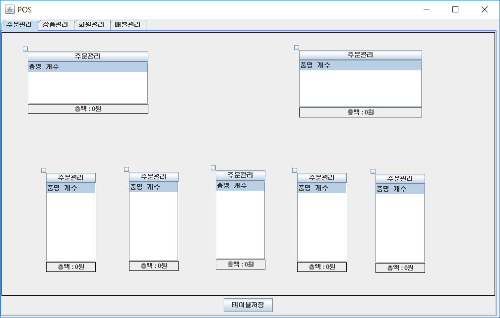

# Java POS

[English](README.md)

매장의 테이블 배치, 주문과 결제, 상품, 회원, 매출을 다루는 Java Swing 데스크톱 POS 프로그램이다. 데이터는 JDBC 로 MySQL 에 저장하고, 옮기고 크기를 바꾸는 테이블 위젯과 매출 그래프, 영수증 바코드는 Swing 과 AWT 로 직접 그렸다. 팀 프로젝트로, 팀장과 메인 프로그래밍을 맡았다.

<p>
  
</p>


## 사용 방법

Releases에서 받은 압축 파일에는 실행 jar 와 DB 스키마가 들어 있다. 실행하려면 Java 8 이상과 MySQL 서버, MySQL Connector/J 가 있어야 한다.

1. MySQL 서버를 `localhost:3306` 에 띄우고 `root` 계정의 비밀번호를 `1234` 로 둔다. 접속 정보는 `MainFrame.java` 에 들어 있다.
2. [docs/schema.sql](docs/schema.sql) 을 실행해 `pos` 데이터베이스와 테이블을 만든다. 코드의 쿼리에서 재구성한 스키마다.
3. MySQL Connector/J 를 받아 jar 옆에 둔다. 드라이버 클래스로 `com.mysql.jdbc.Driver` 를 쓰므로 5.1 판(예: `mysql-connector-java-5.1.49.jar`)이어야 한다. Maven Central 의 `mysql:mysql-connector-java` 에서 받을 수 있다.
4. 커넥터를 클래스패스에 넣고 `MainFrame` 을 실행한다. 클래스패스 구분자는 Windows 가 `;`, macOS 와 Linux 가 `:` 다.

```
mysql -u root -p < schema.sql
java -cp "java-pos.jar;mysql-connector-java-5.1.49.jar" MainFrame
```

| 탭 | 내용 |
|---|---|
| 주문관리 | 빈 곳을 오른쪽 클릭해 "좌석추가" 로 테이블을 놓는다. 테이블 가장자리를 클릭하면 마우스를 따라 움직이고, 빈 곳을 클릭하면 그 자리에 놓인다. 왼쪽 위의 작은 버튼을 누르면 같은 방식으로 크기를 바꾼다. 테이블 가장자리를 오른쪽 클릭하면 삭제할 수 있다. "테이블저장" 을 누르면 배치가 DB 에 저장되어 다음 실행 때 다시 나온다 |
| 상품관리 | 상품 등록, 상품번호로 조회한 뒤 수정과 삭제 |
| 회원관리 | 회원 등록, 회원번호로 조회한 뒤 수정과 삭제. 새 회원은 포인트 100, 등급 "일반" 으로 시작한다 |
| 매출관리 | 날짜별 매출액 표와 꺾은선 그래프 |

테이블의 "주문관리" 버튼을 누르면 주문 창이 열린다. 오른쪽 상품목록에서 상품을 클릭하면 주문목록에 하나 담기고 재고가 하나 줄며, 주문목록의 줄을 클릭하면 하나 빠지고 재고가 돌아온다. 재고는 클릭할 때마다 DB 에 바로 반영된다. "계산" 을 누르면 오늘 날짜와 총액이 결제 기록 `pay` 에 남고 테이블이 비워진다. 그 뒤 "영수증" 을 누르면 주문 내역과 바코드가 찍힌 영수증 창이 뜬다. 스키마에서 `sales` 는 `pay` 를 월별로 합친 뷰라서 결제가 쌓이면 매출관리 탭에 나온다.

소스는 UTF-8 로 저장되어 있어 직접 컴파일할 때는 `javac -encoding UTF-8` 을 쓴다.


## 구현 원리

**옮기고 크기를 바꾸는 위젯을 직접 만들었다.** `Anchor` 는 아무 컴포넌트나 감싸는 패널이다. 감싼 컴포넌트보다 사방 10픽셀 크게 잡고 왼쪽 위에 10x10 버튼을 둔다. 몸통을 누르면 이동 상태가 되어 부모 패널의 `mouseMoved` 마다 커서를 따라가고, 왼쪽 위 버튼을 누르면 크기 조절 상태가 되어 커서가 움직인 만큼 왼쪽 위 모서리를 옮기며 너비와 높이를 바꾼다. 위젯을 커서보다 10픽셀 오른쪽 아래에 두어 커서가 계속 부모 패널 위에 있으므로 부모가 마우스 이벤트를 받는다. 부모 패널을 한 번 더 누르면 상태가 풀린다. 주문관리 탭의 테이블(`PosTable`)과 매출관리 탭의 그래프(`Graph`)가 둘 다 이 위젯에 들어 있다.

```java
parent.addMouseMotionListener(new MouseAdapter() {
    @Override
    public void mouseMoved(MouseEvent e) {
        if (Anchor.this.isBodyClicked) {
            Anchor.this.setLocation(e.getX() + 10, e.getY() + 10);
        }
        if (Anchor.this.isAnchorClicked)
        {
            int margin = 10;
            Point deltaLocation = new Point(e.getX() - Anchor.this.getX() + margin, e.getY() - Anchor.this.getY() + margin);
            Anchor.this.setDeltaSize(-deltaLocation.x , -deltaLocation.y);
            Anchor.this.setLocation(e.getX() + margin, e.getY() + margin);
        }
    }
});
```

**테이블 배치는 통째로 다시 쓴다.** "테이블저장" 은 `table_info` 를 비우고 보이는 테이블의 크기와 위치를 한 줄씩 넣는다. 삭제한 테이블은 숨겨 두기만 하므로 저장할 때 빠진다. 프로그램을 켜면 이 표를 읽어 테이블을 다시 놓는다.

**바코드는 영수증을 연 시각을 이진수로 그린다.** 월, 일, 시, 분, 초를 이어 붙인 숫자를 `Barcode` 가 32비트 이진 문자열로 바꾸고 `01` 을 덧붙인 뒤, 1 인 자리마다 세로 막대를 긋는다. 막대 폭은 캔버스 폭을 자릿수로 나눈 값이다.

```java
for (int i = binaryString.length() - 1, j = 0; i >= 0; i--, j++)
{
    if (binaryString.charAt(i) == '1')
    {
        g2d.draw(new Line2D.Float(barWidth * j, 0, barWidth * j, getHeight()));
    }
}
```

**그래프는 최솟값과 최댓값으로 정규화한다.** `Graph` 는 가로축, 세로축, 본체를 각각 `Canvas` 로 두고, 본체는 값마다 최솟값과 최댓값 사이의 비율로 높이를 정해 점을 찍고 앞 점과 선으로 잇는다. 매출관리 탭을 열 때마다 `sales` 를 다시 읽고, 날짜에서 `-` 를 뺀 숫자를 가로축 이름표로 쓴다.


## 파일

| 경로 | 내용 |
|---|---|
| `source/src/MainFrame.java` | 메인 창과 탭, DB 접속 정보, 테이블 배치 저장과 불러오기 |
| `source/src/Anchor.java` | 옮기고 크기를 바꾸는 위젯 |
| `source/src/PosTable.java` | 주문관리 탭의 테이블 |
| `source/src/OrderFrame.java` | 주문 창, 재고 반영과 결제 |
| `source/src/ReceiptFrame.java`, `source/src/Barcode.java` | 영수증과 바코드 |
| `source/src/Graph.java` | 매출 그래프 |
| `source/src/Item*.java`, `source/src/Member*.java` | 상품과 회원의 등록, 수정, 삭제 창 |
| `source/.project`, `source/.classpath` | Eclipse 프로젝트 파일 |
| `docs/schema.sql` | 코드의 쿼리에서 재구성한 `pos` DB 스키마 |
| `docs/screenshots/` | 스크린샷 |
| Releases | 실행 jar 와 DB 스키마 |


## 라이선스

zlib 라이선스다. 자세한 내용은 [LICENSE](LICENSE) 에 있다.
